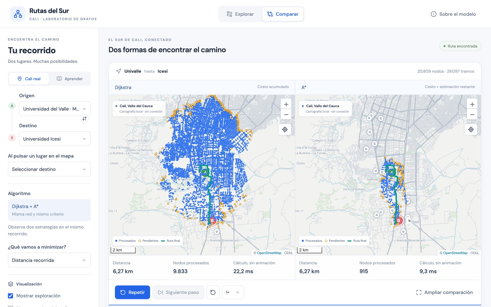
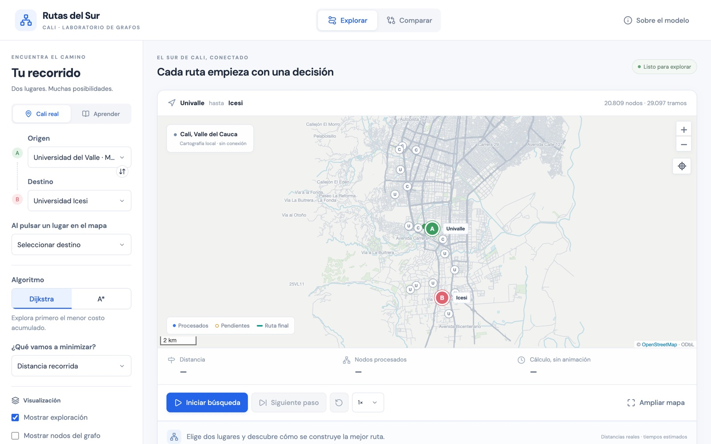
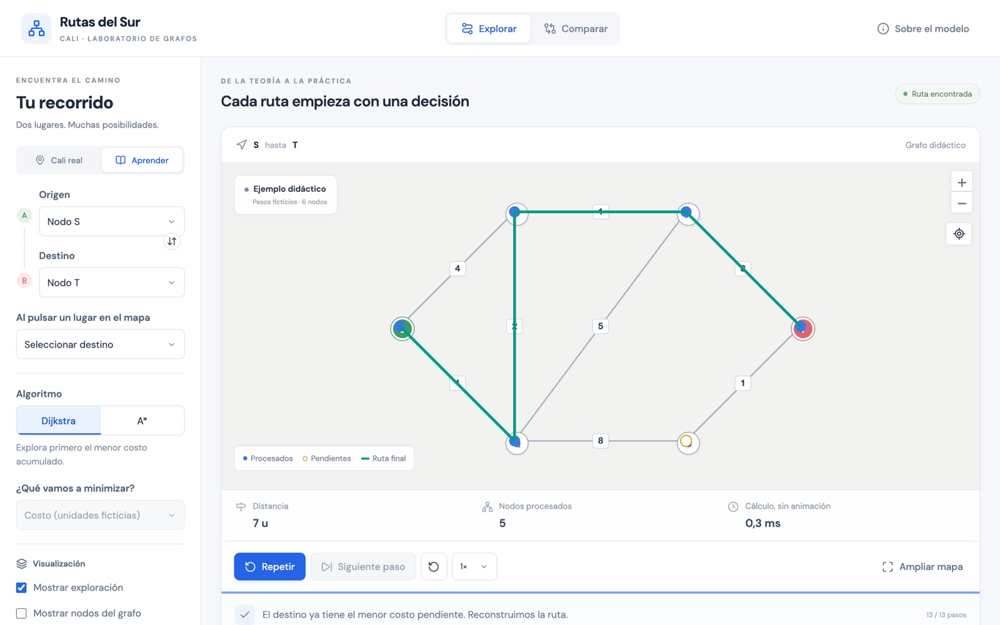
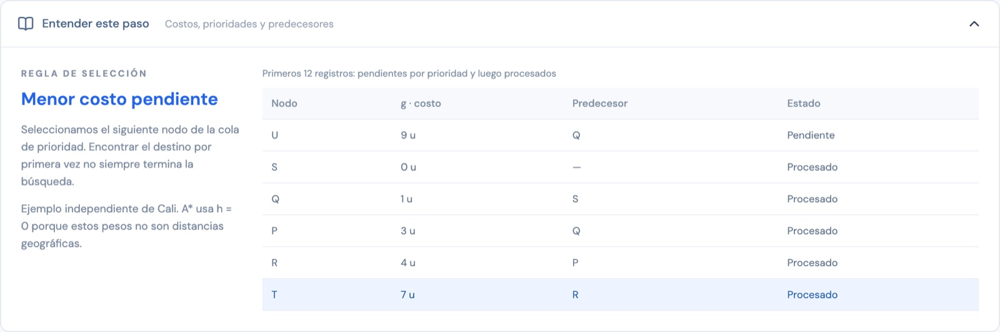
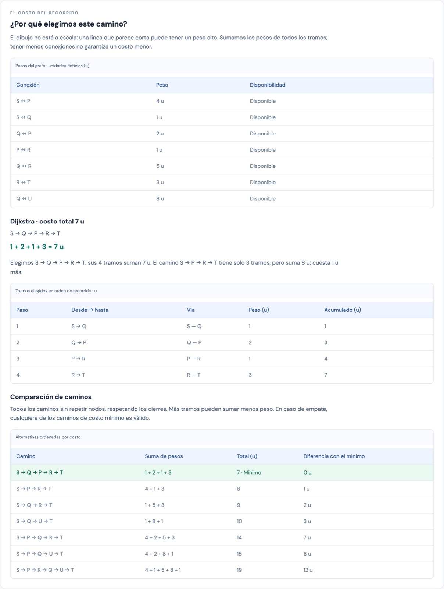
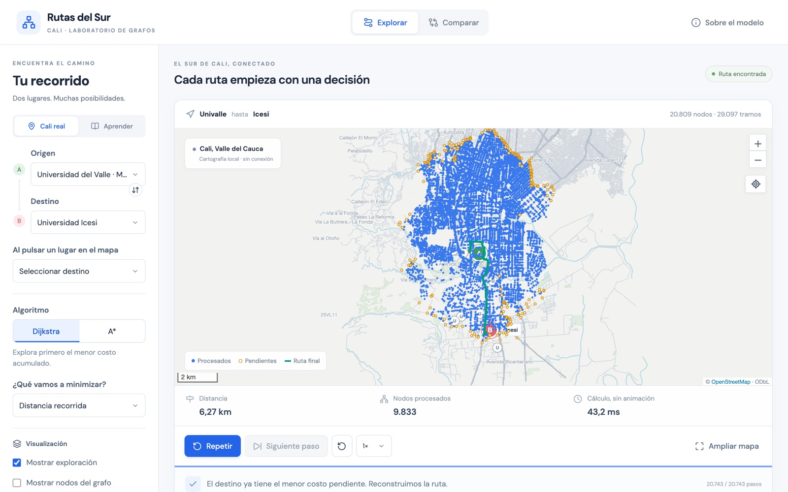
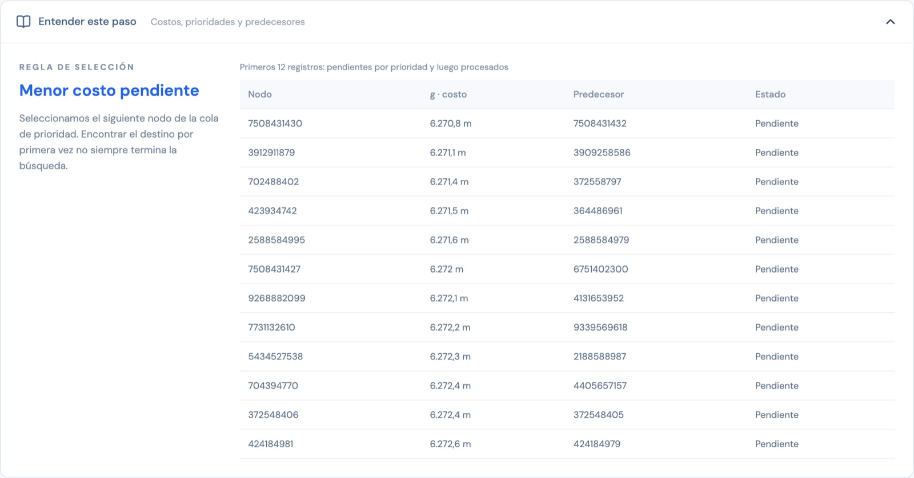
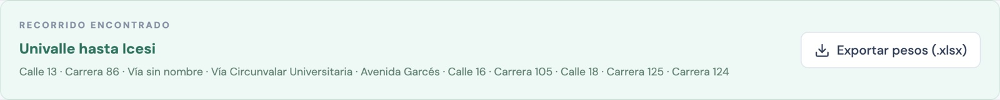
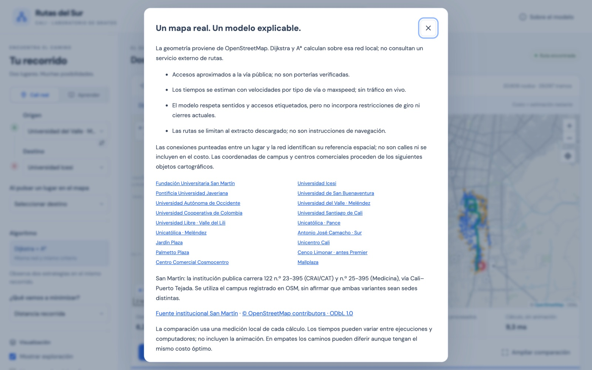

<p align="center">
  
</p>

<h1 align="center">Dijkstra · Actividad 10 · Matemáticas Discretas</h1>

<p align="center">
  <strong>Rutas del Sur</strong>: caminos mínimos en la red vial del sur de Cali con los algoritmos de Dijkstra y A*
</p>

<p align="center">
  <a href="https://dijkstraactividad10.vercel.app/"></a>
</p>

<p align="center">
  <a href="#windows"></a>
  <a href="#macos-apple-silicon"></a>
  <a href="#macos-intel"></a>
</p>

<p align="center">
  
  
  
  
</p>

<p align="center">
  
</p>

---

## Contenido

- [Qué es Rutas del Sur](#qué-es-rutas-del-sur)
- [Descargas](#descargas)
- [Instalación paso a paso](#instalación-paso-a-paso)
  - [Windows](#windows)
  - [macOS Apple Silicon](#macos-apple-silicon)
  - [macOS Intel](#macos-intel)
- [Versión web](#versión-web)
- [Cómo funciona el aplicativo](#cómo-funciona-el-aplicativo)
- [Dijkstra y A* en una tabla](#dijkstra-y-a-en-una-tabla)
- [Verificar la descarga](#verificar-la-descarga)
- [Preguntas frecuentes](#preguntas-frecuentes)
- [Alcance y límites](#alcance-y-límites)
- [Autor](#autor)
- [Créditos y licencias](#créditos-y-licencias)

---

## Qué es Rutas del Sur

Rutas del Sur es el proyecto integrador de la **Actividad 10 de Matemáticas Discretas** en la Universidad Autónoma de Occidente. Representa las vías del sur de Cali como un **grafo dirigido y ponderado** y calcula el camino de menor costo entre universidades y centros comerciales con dos algoritmos:

| | Algoritmo | Prioridad de la cola | Idea |
|---|---|---|---|
| 🔴 | **Dijkstra** | `f(n) = g(n)` | Procesa siempre el nodo pendiente con menor costo acumulado desde el origen. |
| 🔵 | **A\*** | `f(n) = g(n) + h(n)` | Suma una estimación de lo que falta (la distancia en línea recta al destino) para orientarse hacia él. |

El aplicativo no solo da la respuesta: muestra la búsqueda paso a paso, explica cada relajación, enseña la tabla de pesos con la que se justifica el resultado y exporta todo a Excel.

| Dato | Valor |
|---|---|
| Lugares del catálogo | 18 (12 sedes educativas y 6 centros comerciales) |
| Nodos de la red vial | 20.809 |
| Segmentos viales | 29.097 |
| Criterios | Distancia recorrida o tiempo estimado |
| Fuente de datos | OpenStreetMap, extracción del 22 de noviembre de 2026 |
| Conexión a internet | No la necesita: la cartografía viene dentro del instalador |

---

## Descargas

Los instaladores están en la sección **[Releases](../../releases/latest)** de este repositorio. Elija el que corresponde a su equipo:

| Sistema | Archivo | Tamaño | Descarga directa |
|---|---|---|---|
|  | `RutasDelSur-0.2.0-Windows-x64.exe` | 126 MB | [⬇️ Descargar para Windows](../../releases/latest/download/RutasDelSur-0.2.0-Windows-x64.exe) |
|  | `RutasDelSur-0.2.0-macOS-AppleSilicon.dmg` | 130 MB | [⬇️ Descargar para Mac Apple Silicon](../../releases/latest/download/RutasDelSur-0.2.0-macOS-AppleSilicon.dmg) |
|  | `RutasDelSur-0.2.0-macOS-Intel.dmg` | 134 MB | [⬇️ Descargar para Mac Intel](../../releases/latest/download/RutasDelSur-0.2.0-macOS-Intel.dmg) |

> [!TIP]
> **¿Mi Mac es Apple Silicon o Intel?** Abra el menú  → **Acerca de esta Mac**. Si dice **Chip Apple M1, M2, M3 o M4**, descargue la versión *Apple Silicon*. Si dice **Procesador Intel**, descargue la versión *Intel*.

> [!NOTE]
> Los instaladores **no están firmados** con un certificado de desarrollador (es un proyecto académico). Windows y macOS mostrarán un aviso la primera vez; abajo se explica cómo abrirlo de forma segura sin desactivar ninguna protección del equipo.

---

## Instalación paso a paso

### Windows

 Archivo: `RutasDelSur-0.2.0-Windows-x64.exe`

1. Descargue el instalador desde [Releases](../../releases/latest/download/RutasDelSur-0.2.0-Windows-x64.exe).
2. Haga doble clic sobre el archivo.
3. Si aparece **"Windows protegió su PC"** (SmartScreen), pulse **Más información** y luego **Ejecutar de todas formas**.
4. Elija la carpeta de instalación (o deje la predeterminada) y pulse **Instalar**.
5. Al terminar, abra **Rutas del Sur** desde el acceso directo del escritorio o desde el menú Inicio.

Para desinstalarlo: **Configuración → Aplicaciones → Rutas del Sur → Desinstalar**.

### macOS Apple Silicon

 Archivo: `RutasDelSur-0.2.0-macOS-AppleSilicon.dmg`

1. Descargue el instalador desde [Releases](../../releases/latest/download/RutasDelSur-0.2.0-macOS-AppleSilicon.dmg).
2. Haga doble clic en el `.dmg` y arrastre **Rutas del Sur** a la carpeta **Aplicaciones**.
3. Abra **Aplicaciones**, haga **clic derecho** sobre Rutas del Sur y elija **Abrir**. Confirme con **Abrir** en el aviso.
4. Si macOS no ofrece el botón **Abrir**: vaya a **Configuración del Sistema → Privacidad y seguridad**, baje hasta el mensaje sobre *Rutas del Sur* y pulse **Abrir igualmente**.
5. Desde la segunda vez se abre con doble clic, como cualquier aplicación.

Para desinstalarlo: arrastre **Rutas del Sur** desde Aplicaciones a la Papelera.

### macOS Intel

 Archivo: `RutasDelSur-0.2.0-macOS-Intel.dmg`

1. Descargue el instalador desde [Releases](../../releases/latest/download/RutasDelSur-0.2.0-macOS-Intel.dmg).
2. Siga los mismos pasos 2 a 5 de [macOS Apple Silicon](#macos-apple-silicon).

> [!IMPORTANT]
> En los Mac se habla de **macOS**, no de iOS: iOS es el sistema del iPhone y del iPad, donde este instalador no funciona. Desde un iPhone o iPad use la [versión web](#versión-web).

---

## Versión web

Si no quiere instalar nada, o está en un celular o tableta, use la versión web. Es el mismo aplicativo, con los mismos datos y algoritmos:

<p align="center">
  <a href="https://dijkstraactividad10.vercel.app/"><strong>🌐 https://dijkstraactividad10.vercel.app/</strong></a>
</p>

<p align="center">
  
</p>

---

## Cómo funciona el aplicativo

### 1. La pantalla principal

A la izquierda se eligen el escenario, el origen, el destino, el algoritmo y el criterio (distancia o tiempo). En el centro está el mapa, y debajo, el costo, los nodos procesados, el tiempo de cálculo y los controles de reproducción.

<p align="center"></p>

### 2. Aprender con un grafo pequeño

El escenario **Aprender** usa un grafo de seis nodos (S, P, Q, R, U, T) con pesos ficticios. Es la forma más clara de ver qué hace el algoritmo antes de pasar a la red de Cali.

| Antes de buscar | Resultado: S → Q → P → R → T, costo 7 |
|---|---|
|  |  |

Con **Siguiente paso** se avanza un evento a la vez. En el panel **Entender este paso** se ve la relajación clave: P empieza con costo 4 (por S → P), pero al procesar Q aparece un camino mejor, 1 + 2 = 3, y P se actualiza.

<p align="center"></p>

### 3. Justificar la respuesta con la tabla de pesos

La sección **¿Por qué elegimos este camino?** muestra los pesos de cada conexión, los tramos elegidos con su acumulado y todos los caminos alternativos ordenados por costo. Así se ve por qué un camino de cuatro tramos (costo 7) le gana a uno de tres (costo 8).

<p align="center"></p>

### 4. Buscar en la red real de Cali

En **Cali real** se escogen dos lugares, por ejemplo Univalle e Icesi. En azul aparecen los nodos procesados, en ámbar los pendientes y en verde la ruta final.

<p align="center"></p>

<p align="center"></p>

### 5. Comparar Dijkstra y A*

La pestaña **Comparar** ejecuta los dos algoritmos sobre la misma red, con el mismo criterio y los mismos cierres. En la ruta Univalle → Icesi por distancia, ambos llegan a **6,27 km**, pero Dijkstra procesa **9.833 nodos** y A\* solo **915**.

<p align="center"></p>

### 6. Exportar a Excel

Al terminar una búsqueda, **Exportar pesos (.xlsx)** descarga un archivo con las hojas Resumen, Ruta y Decisiones de cada algoritmo. Los acumulados se calculan con fórmulas, así que el resultado se puede comprobar fuera del aplicativo.

<p align="center"></p>

### 7. Fuentes y alcance

**Sobre el modelo** explica los límites del modelo y enlaza el objeto de OpenStreetMap de cada lugar.

<p align="center"></p>

### Controles

| Control | Qué hace |
|---|---|
| Iniciar búsqueda / Pausar / Continuar | Inicia, detiene o reanuda la animación |
| Siguiente paso | Avanza un evento y deja la animación en pausa |
| Ver resultado | Muestra el resultado final sin esperar la animación |
| Velocidad 1× · 2× · 4× | Cambia el ritmo de la animación; los pesos no cambian |
| Simular cierre de vías | Permite cerrar un tramo en el mapa y recalcular |
| Ampliar mapa / comparación | Pantalla completa; Esc vuelve al panel |

---

## Dijkstra y A* en una tabla

| | 🔴 Dijkstra | 🔵 A\* |
|---|---|---|
| Prioridad | `g(n)` | `g(n) + h(n)` |
| Información extra | Ninguna | Distancia en línea recta al destino |
| Forma de explorar | En todas las direcciones desde el origen | Orientada hacia el destino |
| Univalle → Icesi | 6,27 km · 9.833 nodos | 6,27 km · 915 nodos |
| ¿Garantiza el óptimo? | Sí, con pesos no negativos | Sí, con una heurística admisible y consistente |
| En el modo Aprender | Igual | Usa `h = 0`, así que se comporta igual que Dijkstra |

Relajación, común a ambos:

```
si g(u) + w(u, v) < g(v)  entonces  g(v) ← g(u) + w(u, v)  y  predecesor(v) ← u
```

---

## Verificar la descarga

Para comprobar que el archivo no se dañó al descargarlo, compare su huella SHA-256 con la de esta tabla (también está en `SHA256SUMS.txt`, dentro del Release):

| Archivo | SHA-256 |
|---|---|
| `RutasDelSur-0.2.0-Windows-x64.exe` | `1650b04f5cae4deba55bf1d36ea8c97c076c0763da13e89cebe73bb05b41c3e7` |
| `RutasDelSur-0.2.0-macOS-AppleSilicon.dmg` | `3e289dfbff18b35515e423ecc20b68a7096a4a0ebea5ff60143a6b0626a741e9` |
| `RutasDelSur-0.2.0-macOS-Intel.dmg` | `92242fb10beb092a1a4f9a0f23172aabdb7c174612f5177f3384ed538a2b37e0` |

En Windows (PowerShell):

```powershell
Get-FileHash .\RutasDelSur-0.2.0-Windows-x64.exe -Algorithm SHA256
```

En macOS (Terminal):

```bash
shasum -a 256 RutasDelSur-0.2.0-macOS-AppleSilicon.dmg
```

---

## Preguntas frecuentes

<details>
<summary><strong>¿Necesito internet para usar la versión de escritorio?</strong></summary>

No. La cartografía y las fuentes vienen dentro del instalador. Solo hace falta internet para descargarlo.
</details>

<details>
<summary><strong>macOS dice que la aplicación "está dañada" o "no se puede abrir".</strong></summary>

Es el aviso para aplicaciones no firmadas. Use **clic derecho → Abrir**, o **Configuración del Sistema → Privacidad y seguridad → Abrir igualmente**. Verifique también que descargó la versión correcta para su chip (Apple Silicon o Intel).
</details>

<details>
<summary><strong>¿Por qué A* se ve igual que Dijkstra en el modo Aprender?</strong></summary>

Es intencional. Los pesos del ejemplo son ficticios y el dibujo no tiene escala, así que no hay una distancia real que usar como estimación. Con `h = 0`, A\* se comporta exactamente como Dijkstra. La diferencia se ve en la red de Cali.
</details>

<details>
<summary><strong>¿Por qué cambia la ruta al pasar de Distancia a Tiempo estimado?</strong></summary>

Cada criterio usa pesos distintos: metros en un caso y segundos (según la velocidad de cada vía) en el otro. La ruta más corta no siempre es la más rápida.
</details>

<details>
<summary><strong>No aparece ninguna ruta.</strong></summary>

Revise si hay tramos cerrados con **Simular cierre de vías**. Use **Reabrir tramos** y calcule de nuevo.
</details>

---

## Alcance y límites

- El resultado es el camino óptimo **dentro del grafo y de los pesos incluidos**.
- Los accesos a los recintos son aproximados y no se verificaron en campo.
- No se modelan tráfico en tiempo real, semáforos ni restricciones de giro.
- Es un laboratorio educativo, no un sistema de navegación vehicular.

---

## Autor

<table>
  <tr>
    <td>
      <strong>Daniel Barco Almache</strong><br>
      Universidad Autónoma de Occidente<br>
      Matemáticas Discretas · Grupo 2 · Docente: Oswaldo Rodriguez Diaz<br><br>
      📧 Institucional: <a href="mailto:daniel.barco@uao.edu.co">daniel.barco@uao.edu.co</a><br>
      📧 Personal: <a href="mailto:barcodaniel501@gmail.com">barcodaniel501@gmail.com</a><br>
      🐙 GitHub: <a href="https://github.com/barcodaniel501">@barcodaniel501</a>
    </td>
  </tr>
</table>

---

## Créditos y licencias

- **Datos viales:** © colaboradores de OpenStreetMap, disponibles bajo la licencia [ODbL 1.0](https://www.openstreetmap.org/copyright).
- **Aplicativo:** licencia MIT (ver [`LICENSE`](LICENSE)).
- **Referencias:**
  - Dijkstra, E. W. (1959). *A note on two problems in connexion with graphs*. Numerische Mathematik, 1, 269-271.
  - Hart, P. E., Nilsson, N. J. y Raphael, B. (1968). *A formal basis for the heuristic determination of minimum cost paths*. IEEE Transactions on Systems Science and Cybernetics, 4(2), 100-107.
- El logo de la Universidad Autónoma de Occidente se usa solo para identificar el contexto académico del proyecto.
